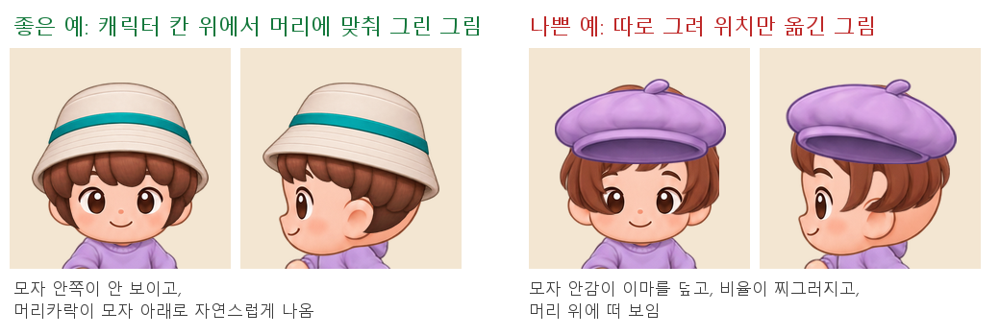
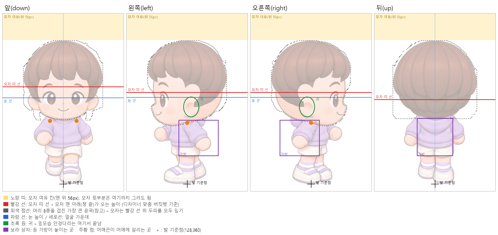

# 메이크파크 캐릭터 아이템 그림 요청서

메이크파크는 머리·얼굴·옷·신발·모자·안경·머리핀·가방을 골라 내 캐릭터를 만들고, 공원을 네 방향으로 걸어 다니는 게임입니다.
지금 아이템이 캐릭터에 잘 맞지 않는 이유는 **아이템을 캐릭터 없이 따로 그렸기 때문**입니다. 모자는 아래에서 올려다본 각도라 안감이 이마를 덮고, 크기와 비율이 머리와 다르고, 옆모습 가방은 좌우가 반대로 그려져 있습니다.

반대로, 이미 잘 맞는 그림(머리1+버킷햇, 안경, 노랑 배낭)은 모두 **캐릭터 칸 위에서 기준 캐릭터에 대고 그린 그림**입니다. 이번 요청은 나머지 아이템도 모두 이 방식으로 그려 달라는 것입니다.



---

## 1. 공통 규격 (꼭 지켜 주세요)

| 항목 | 규격 |
|---|---|
| 캔버스 | **256 × 376 px**, PNG, 투명 배경(RGBA) |
| 기준 | 발 기준점 **(128, 360)**. 기존 캐릭터 그림(256×320)을 **아래로 56px** 내려 놓은 칸입니다. 위 56px는 모자 여유 공간입니다. |
| 방향 | `down`(앞) `left`(왼쪽을 봄) `right`(오른쪽을 봄) `up`(뒤) — 4장 모두 |
| 그림체 | 지금 캐릭터와 같은 색감, 갈색 외곽선 두께, 위쪽에서 오는 부드러운 빛. 새 스타일 금지 |
| 가장자리 | 깔끔한 반투명 가장자리. 검정·흰색 테두리 띠, 번진 자국, 바닥 그림자 금지 |
| 크기 | 확대·축소하지 않고 **템플릿 위에서 실제 크기로** 그리기. 크게 그렸다면 정확히 같은 비율로 줄여서 저장 |
| 걷기 | 몸 맨 위(목 높이)는 걷는 동안 움직이지 않습니다. 그래서 모자·머리핀·가방은 **방향마다 1장**이면 됩니다(걷기 4칸 따로 그릴 필요 없음). |

### 템플릿 쓰는 법
`template_down.png`, `template_left.png`, `template_right.png`, `template_up.png`(2배 크기 512×752)를 맨 아래 층에 깔고, 그 위 새 층에 그린 뒤 **템플릿 층은 끄고** 256×376으로 저장해 주세요.



- **노랑 띠**: 모자 여유 칸. 모자 윗부분은 여기까지 그려도 됩니다.
- **빨강 선(모자 띠 선)**: 모자 맨 아래(챙 끝)가 오는 높이. 디자이너가 맞춰 그린 버킷햇(`fitted/bucket_hair1`)에서 잰 값입니다. 모든 모자가 이 선을 씁니다. 뒷모습(up)은 모자가 뒤통수를 더 덮어서 선이 조금 낮습니다.
- **회색 점선**: 머리 8종을 모두 겹친 가장 큰 머리 윤곽(참고). 모자를 쓰면 빨강 선 위 머리카락은 '모자 쓴 머리'(B)에서 없어지므로, 모자는 **빨강 선 위의 두피(머리 모양)**를 다 덮으면 됩니다.
- **파랑 선**: 눈 높이, 세로선은 얼굴 가운데.
- **초록 원**: 귀. 옆모습 안경다리는 여기서 끝납니다.
- **보라 상자 / 주황 점**: 등 가방이 놓이는 곳 / 어깨끈이 어깨에 걸리는 곳.

---

## 2. 그려 줄 목록과 파일 이름

모든 파일은 `worn/` 폴더에 넣어 주세요. `{dir}`은 `down` `left` `right` `up`.

### A. 모자 — 앞 조각과 뒤 조각으로 나눠서 (최대 32장)
모자는 머리보다 **앞에 오는 부분**과 **뒤에 가려지는 부분**이 있어서 한 장으로는 자연스럽게 씌울 수 없습니다.

| 파일 | 내용 |
|---|---|
| `hat_{이름}_front_{dir}.png` | 머리카락 **위에** 그리는 부분: 바깥에서 보이는 모자 몸통, 앞챙, 밴드 |
| `hat_{이름}_back_{dir}.png` | 머리 **뒤에** 그리는 부분: 머리 뒤로 넘어가는 챙·테두리. 없으면 보내지 않아도 됩니다 |

`{이름}`: `cap`(청록 야구모자) `bucket`(아이보리 버킷햇) `beret`(보라 베레모) `headband`(코랄 머리띠)

- 모자 안감(머리가 들어가는 입구 안쪽)은 **그리지 않습니다.** 그 자리에는 머리카락이 보여야 합니다.
- 모자 맨 아래(챙 끝)를 **빨강 선**에 맞춥니다(±14px).
- 머리띠는 머리카락 위에 얹는 것이라, 양 끝(귀 쪽)만 `back`으로 나눠 주세요.
- 참고 예시: `assets/avatar/fitted/bucket_hair1_*.png`.

### B. 모자 쓴 머리 — 머리 8종 × 4방향 = 32장
모자를 쓰면 모자 위로 머리카락이 삐져나오면 안 됩니다. 머리마다 "모자 쓴 버전"이 필요합니다.

| 파일 | 내용 |
|---|---|
| `hathair_{머리번호}_{dir}.png` | 기존 `hair/{번호}_{dir}.png`에서 **빨강 선 위쪽을 없애고**, 모자 아래로 나오는 앞머리·옆머리·뒷머리만 남긴 그림 |

- 머리 번호: 1 버섯컷, 2 가르마 숏컷, 3 웨이브 숏컷, 4 단발, 5 긴 머리, 6 포니테일, 7 양갈래, 8 곱슬머리
- 모든 모자가 같은 빨강 선을 쓰므로 **머리마다 한 벌**이면 모자 4종에 다 맞습니다. 머리띠는 원래 머리를 씁니다.
- 위쪽 경계는 일자로 자르지 말고, 모자 안쪽으로 들어가듯 자연스럽게 마무리해 주세요.

### C. 머리핀 — 3종 × 3방향 = 9장
| 파일 | 내용 |
|---|---|
| `clip_{이름}_{dir}.png` | 머리1(버섯컷) 기준 캐릭터의 **왼쪽 머리**(정면에서는 화면 오른쪽) 머리카락 위에 꽂힌 모습 |

`{이름}`: `clip_star` `clip_bow` `clip_flower`. `right`(오른쪽을 볼 때)는 핀이 반대편이라 그리지 않습니다.

### D. 가방 — 2종 × 4방향 × 2조각 (최대 16장)
| 파일 | 내용 |
|---|---|
| `bag_{이름}_body_{dir}.png` | 가방 몸통. 앞·옆에서는 몸 **뒤**, 뒤에서는 몸 **위**에 그립니다. 보라 상자 안에 |
| `bag_{이름}_straps_{dir}.png` | 어깨끈. 몸 위, 머리 아래에 그립니다. 주황 점(어깨)에서 시작. 뒤(up)는 필요 없음 |

`{이름}`: `bag_coral`(코랄 배낭) `bag_navy`(네이비 가방)
- 네이비 가방이 **배낭**이면 코랄과 같은 방식으로, **크로스백**이면 한쪽 어깨에서 반대쪽 허리로 내려오는 끈과, 허리 옆에 매달린 가방으로 그려 주세요.
- 옆모습 가방 몸통은 **등 쪽**(왼쪽을 보면 화면 오른쪽)에 붙어 있어야 합니다.
- 참고 예시: `assets/avatar/fitted/bag_yellow_*.png`, `bag_straps_*.png`.

### E. 기존 머리 그림 고치기 — 5장
아래 그림은 머리카락 끝이 **일자로 잘려** 있습니다. 끝까지 자연스럽게 다시 그려 주세요(256×320 기존 규격, 같은 파일 이름).

`hair/6_left.png`, `hair/6_right.png`, `hair/6_up.png`(포니테일), `hair/7_down.png`, `hair/7_up.png`(양갈래)

### F. 안경
지금 맞춤 그림(`fitted/glasses_*`)을 그대로 씁니다. 새로 그릴 필요 없습니다.

---

## 3. 게임이 겹쳐 그리는 순서 (아래 → 위)
1. 앞·옆: 가방 몸통 (`bag_*_body`)
2. 몸(옷·팔다리) → 신발
3. 어깨끈 (`bag_*_straps`) / 뒤(up): 가방 몸통
4. 모자 뒤 조각 (`hat_*_back`)
5. 얼굴 → 머리(모자를 쓰면 `hathair`) → 안경
6. 머리핀 → 모자 앞 조각 (`hat_*_front`)

---

## 4. AI 그림 도구로 만들 때
- 템플릿 그림과 `example_good_bad.png`의 좋은 예를 **참고 이미지**로 함께 넣고, "이 캐릭터에 씌운 모습만, 투명 배경, 같은 위치·크기"로 요청합니다.
- 한 아이템의 **4방향을 같은 대화에서 이어서** 만들어 색과 모양을 맞춥니다.
- AI는 위치를 픽셀 단위로 정확히 맞추기 어렵습니다. 만든 뒤 템플릿에 겹쳐서 위치를 옮겨 맞추고, 아래 검사를 꼭 통과시켜 주세요.

## 5. 보내는 방법과 검사
`worn/` 폴더(와 고친 `hair/` 그림)를 ZIP으로 보내 주세요. 받으면 아래 명령으로 규격·위치를 검사하고, 네 방향 미리보기 그림을 만듭니다.

```bash
python tools/avatar_check_worn.py worn
```

검사 항목: 캔버스 크기, 투명 배경, 가장자리 띠, 모자 아래 가장자리가 빨강 선 근처인지, 모자 쓴 머리에 빨강 선 위 머리카락이 남았는지, 가방·끈이 보라 상자·주황 점 근처인지, 빠진 파일.
